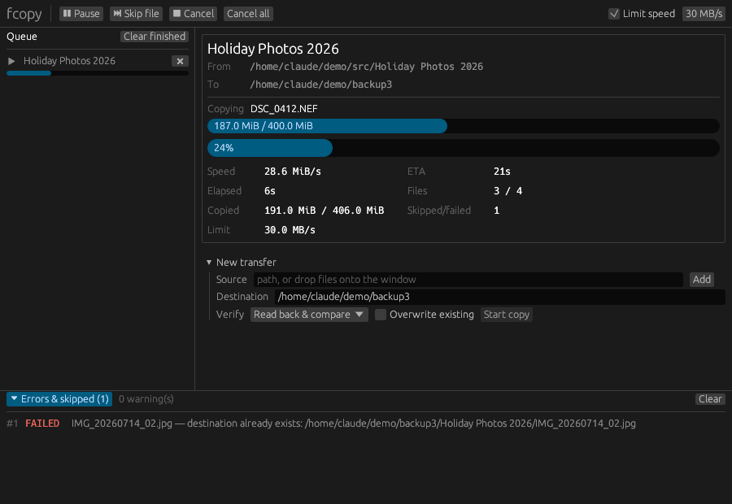

# fcopy

Fast, verified file copying for Windows, macOS and Linux: a TeraCopy-style
engine with a CLI, an egui GUI, and a web console. Upload and download files
between paired PCs over authenticated QUIC.



```sh
cargo test --workspace
cargo run --release -p fc-cli -- copy ~/Photos /mnt/backup --verify readback --limit 50MB
cargo run --release -p fc-gui
```

* Pipelined copy with pre-allocated aligned buffers, atomic `.fcpart` + rename
* XXH3 / SHA-256 / MD5, read-back verification that bypasses the page cache
* Free-space pre-check, Retry / Skip / Cancel recovery, pause / resume / skip-file
* Live speed limit, throttled telemetry (speed, ETA, percent), job queue
* Metadata, long paths and Windows-safe names: see [docs/PLATFORM.md](docs/PLATFORM.md)

## Linux downloads

Linux release packaging covers Ubuntu/Debian `.deb`, Fedora `.rpm`, Arch
`.pkg.tar.zst`, and AppImage (x86-64). Version-tag CI builds and tests the packages
before publishing them to [GitHub Releases](https://github.com/DMG-Workshop/FCOPY/releases).
Packages include the CLI and desktop app, not an automatically enabled agent or
web server. See the [Linux packaging guide](packaging/linux/README.md) for
installation, compatibility, local builds, checksums and the release process.

## macOS and hosted deployments

Native Apple Silicon and Intel DMGs include the desktop app and CLI.
They are ad-hoc signed, **not notarized**; see the
[macOS guide](packaging/macos/README.md) for installation and Gatekeeper details.

The standalone `fcopy-web` HTTPS server supports a non-root
`ghcr.io/dmg-workshop/fcopy-web` Docker image, an Unraid user template, and a
native systemd service inside an unprivileged Debian Proxmox LXC.
Accounts, TLS identity and paused recovery persist, with no plaintext passwords
in account files. See the [hosted deployment guide](packaging/hosted/README.md)
for volumes, initial login, TLS and installation. LXC support is an installer
and native archive, not a prebuilt OS image.

## Download from a PC

The remote PC must run a current `fcopy-agent` with an account and a share.
Confirm its fingerprint before connecting. Passwords/access keys are prompted
for or supplied per operation, not saved in profiles.

* **Desktop:** Add task → Download from PC. Enter the PC's address and credentials,
  browse its shares, add files or folders, choose a local destination folder,
  then start the copy.
* **Web console (admins):** Add task → Download from paired PC. Choose the paired
  PC, enter its credentials, browse shares, and queue the selection. The destination
  is on the **console host**, inside a configured local share—not on the browser's
  machine.
* **CLI:** `fcopy copy alice@nas:/backup/photos DEST` downloads a file or folder.

Desktop and web downloads use the normal queue: pause/resume, cancel, skip
(desktop), live bandwidth limits, progress, and per-file results. They reconnect
and resume interrupted files, re-read and compare downloaded bytes before committing,
and include empty directories. Read-only remote shares are supported. Existing
local links/junctions and colliding destination names are rejected rather than
followed or overwritten implicitly. Remote files are transferred sequentially.

Developer context and roadmap: [CLAUDE.md](CLAUDE.md).

## Existing files

Local copies, uploads and downloads support **Ask**, **Replace**, **Skip**,
**Keep both**, and **Compare**. Desktop and web Add task default to **Ask**.
Decisions appear while the queue waits; cancelling or skipping the current file
also releases a pending decision. Web decisions require the job's owner or an
administrator.

* **Keep both** writes `name (copy 1).ext`, increasing the number past occupied
  names. The original is untouched. A file arriving at the chosen destination
  before commit is never silently replaced; the operation fails safely.
* **Compare** reads both files without changing them. Identical files are skipped;
  different contents prompt again for Replace, Skip or Keep both.
* **Apply to remaining conflicts** lasts for this job only. Compare-all and the
  answer for differing files are remembered separately.

The CLI accepts `--conflict ask|replace|skip|keep-both|compare`; `--overwrite`
remains supported but cannot be combined with `--conflict`. Interactive CLI
copies default to Ask. Without a terminal, the default refuses existing files;
an explicit Ask or a comparison that differs fails/cancels safely rather than
waiting for input. Use Replace, Skip or Keep both for unattended jobs.
Uppercase prompt answers apply to remaining conflicts in the job.

Remote comparisons read the remote file over the network, so they can be as
expensive as a download; they honor pause, cancellation and bandwidth limits.
Conflict-enabled uploads serialize small files to keep naming and decisions
consistent. Library callers without a conflict resolver retain the existing
parallel-upload behavior. Explicit skips (including identical comparisons)
retain the existing non-clean result / nonzero CLI exit status.

## Layout and appearance

### One desktop window

Launching `fcopy-gui` again restores and focuses the existing window instead of
starting another copy queue. File-manager **Copy with fcopy** selections
(`--sources PATH...`) open its Add task form; choose a destination before copying.
An explicit `SOURCE... DEST` launch is sent to the same queue, preserving
`--verify` and an explicitly supplied global `--limit`.

An open Add task draft is not overwritten. Incoming selections wait in order;
finish or close the draft to open the next one. Active copies, recovery jobs and
the separate torrent lane continue unchanged. Torrent DHT/tracker startup flags
require closing the existing application before relaunching with those options.

Single-instance ownership is scoped to the client configuration directory
(`FCOPY_CONFIG_DIR` overrides it). An OS-held lock prevents competing GUI queues;
authenticated, bounded loopback IPC forwards launches without exposing a LAN
listener. The runtime endpoint contains a random handoff token, not remote
passwords. Failed handoff is reported instead of silently opening another queue;
after a crash the next launch replaces the stale endpoint automatically.
Pending Add task selections are drafts, not saved recovery jobs, until submitted.
Foreground focus remains subject to the OS/window manager's activation policy;
Windows also requests taskbar attention if foreground permission is declined.

Windows validation (no elevation required): build with `cargo build -p fc-gui`,
then run `.\packaging\windows\test-single-instance.ps1` in an interactive desktop.
The [test script](packaging/windows/test-single-instance.ps1) uses isolated state
and checks a byte-identical forwarded copy, restoration/focus, secondary exit,
and preservation of an open Add task draft.

### Appearance

Desktop and web share a queue-first console design: orange accents, a compact
overall progress card, readable transfer rows, separate History and Recovery
views, and live copy telemetry with a bandwidth cap. Torrent activity stays in
its own tab and does not inflate copy progress. Queue totals cover planned bytes;
pending jobs are measured when they start, so totals can grow.

Open **Settings -> Appearance** (desktop) or **Settings -> Appearance** (web).
Choose **Light**, **Dark**, **Low-contrast** (muted dark surfaces),
**High-contrast** (black surfaces, bright text and borders), or **System**.
System follows the device's OS light/dark setting as it changes; the desktop
falls back to Dark when the OS preference is unavailable. Web layouts use
transfer cards and a collapsible monitor on smaller screens; desktop keeps a
wide queue with a monitor panel when space allows.

The **blue-light filter** is an independent, adjustable warm tint. **Night Shift**
can be Off, On, or Scheduled with start/end times on the viewing device's local
clock, including overnight schedules. When both are enabled, the stronger warmth
wins rather than stacking the filters. Scheduling updates within about 30 seconds
while the app is awake. These are **app-only color adjustments**, not OS/display
filters; they affect color accuracy and may reduce contrast. No health benefit is
implied. Leave both off for the unmodified high-contrast palette.

Changes preview immediately; select **Save appearance** to persist them.
Desktop saves `appearance.toml` in the client configuration directory
(`FCOPY_CONFIG_DIR` overrides it). Web saves `fcopy.appearance.v1` in this
browser's local storage, not in account profiles or on the console host; all
accounts using that browser/origin share the appearance. Blocked storage or
damaged settings are reported rather than silently overwritten. No credentials
are included in appearance settings.

## Transfer history

Open **Transfer history** in the desktop sidebar or **History** in the web console.
The latest **1,000 finished jobs** are retained, newest first, until cleared.
Search names or paths and expand a job for its sources, destination, finish time,
duration, copied bytes, and copied/skipped/failed file counts. Completed,
completed-with-errors, failed and cancelled jobs are included. History is separate
from the live queue: removing a queue row does not delete its summary, and clearing
history changes neither files nor queued jobs.

Desktop summaries are saved in `desktop-history.toml` in the client configuration
directory (`FCOPY_CONFIG_DIR` overrides it). Desktop times are UTC; browser times
use the browser's locale. Web summaries are saved in `transfer-history.toml` inside
the console's configured state directory. With no state directory the web view
explicitly reports memory-only history. Web accounts see/clear only their own
summaries; administrators see and can clear all accounts. The 1,000-job limit is
shared across all accounts on that console.

Only summary fields are saved, never backend objects, passwords, access keys,
session tokens, fingerprints or raw error/log messages. Paths, labels and web
account names **are stored on disk**; use clear history to remove them. Writes are
atomic and locked across app instances. Corrupt history is reported, not silently
discarded. Failed writes stay pending in memory; **Refresh / retry saving** retries
after the storage problem is fixed. An abrupt process exit can lose results still
pending a successful write. History is not crash recovery, a per-file audit log,
or automatic transfer resumption, and does not include CLI or BitTorrent jobs.

Web API: `GET /api/history` returns `{entries, persistent}` (newest first);
`DELETE /api/history` clears the caller's scope and requires the normal
authentication and CSRF header. History IDs remain unique across restarts and
clears; they are not queue job IDs.

## Recover unfinished transfers

Open **Queue recovery** in the desktop sidebar or **Recovery** in the web console.
Local copies, uploads and downloads are saved **before** entering the live queue.
After a restart they appear **paused**, without starting disk work or connecting to
another PC. Choose:

- **Resume**: compare existing destinations by content, skip identical files and
  ask again for differences. Compatible remote partials resume with full-file
  integrity checks. An interrupted local file is safely recopied from byte zero;
  local byte-offset resume is not supported.
- **Retry**: start unfinished files from byte zero with the original conflict
  policy. A connection drop during that attempt can still resume its new partial.
- **Discard**: remove only the saved job. Already copied data and partial files
  are not deleted.

Enter the remote PC's password or access key again for every recovered remote
job. Recovery saves the confirmed fingerprint with the address/share and refuses
an identity change; it never stores passwords, access keys or session tokens.
Saved destinations are snapshots, independent of later PC-profile edits.

Jobs interrupted by closing the app are retained. Successfully finished jobs and
explicitly cancelled/removed unfinished live jobs leave recovery. Failed jobs
remain available to retry. Comparison skips count as skips in the normal
queue/history summaries.
Recovery does not apply to CLI or BitTorrent jobs.

Desktop records live in `unfinished-desktop-jobs.toml` in the client configuration
directory (`FCOPY_CONFIG_DIR` overrides it). Web records use `unfinished-jobs.toml`
in the configured server state directory; without one, recovery is explicitly
memory-only. Paths, labels, copy options, trusted fingerprints and web account
names are saved on disk. Records are written atomically, and advisory claims
prevent two app instances from running or discarding the same job simultaneously.
A failed save prevents execution; corrupt state is reported, not silently reset.

Web accounts see and recover their own local jobs; administrators can manage all
jobs and recover remote jobs. Current local share restrictions are rechecked
before execution. `GET /api/recovery` returns `{jobs, persistent, error}`, with
each job's `state` set to `paused`; `POST /api/recovery/{id}` accepts
`{"action":"resume|retry|discard","password":"..."}` and requires authentication
and the normal CSRF header. Omit `password` for local jobs and discards.
Recovery IDs are independent of live queue IDs and finished-history IDs.

## Saved desktop PCs

Open **Remote PCs → New PC**, or **Save PC profile** beside a discovered agent.
Enter a name and a target such as `alice@nas:47800:/backup/photos`. Targets include
the account, address, port and share/folder; IPv6 addresses use brackets.

**Test / read fingerprint** runs a background TLS reachability check without
sending credentials. Compare a new fingerprint with `fcopy-agent fingerprint`
on the remote PC, check the confirmation box, and save. You can also paste and
confirm a fingerprint while the PC is offline. Testing a saved fingerprint
rejects identity changes; it does not verify account login or share permissions.

Saved rows offer **Upload**, **Download**, **Edit**, **Test connection**, and
confirmed **Remove**. The Add task form also has a saved-PC selector and
**Save as profile** / **Edit profile**. Downloads prefill the saved remote path;
uploads use it as their destination. Enter the account password/access key for
each operation, as before.

Profiles persist in `desktop-profiles.toml` in the client configuration directory,
separately from the web console's paired PCs. Only IDs, names, targets and confirmed
fingerprints are saved, never passwords. A selected profile's pin is enforced
even if a separate `known_hosts` entry differs; profile operations do not change
that file. Changing the address clears the selected identity and password.
Editing/removing a profile invalidates an open form using its previous values;
already queued transfers keep their original settings. Corrupt files and failed
saves are reported instead of silently discarding profiles.

## VPN settings and private PC links

**Desktop Settings / VPN** and **web Settings / VPN** link to official downloads
and help for NordVPN, ExpressVPN, Surfshark, Proton VPN, Mullvad, Private Internet
Access, CyberGhost, Windscribe, TunnelBear, and IPVanish. This is a representative
selection of ten services, not a ranking or endorsement.

The desktop can save an installed app's absolute executable path per provider
and open it on demand. On macOS an `.app` bundle is also supported. Use a path
without quotes or command-line arguments; an empty path removes the saved link.
App links and an optional remote target are saved in `vpn-links.toml` in the
client configuration directory. No VPN credentials are collected or saved.
Web links open on the **browser's device**; the console never launches programs
on its host. Install and connect the VPN on the **console host** for web transfers.

For private PC-to-PC transfers, select **Tailscale** or **ZeroTier** in VPN settings:

1. Follow the [Tailscale quickstart](https://tailscale.com/docs/how-to/quickstart)
   or [ZeroTier guide](https://docs.zerotier.com/start/) on both PCs. Join the same
   private network and authorize both devices.
2. Run `fcopy-agent` on the remote PC with an account and a share. Its listen
   address must include the VPN interface. Permit its UDP port (47800 by default)
   in the host firewall and mesh access rules. Check its configured allowlist;
   if necessary, allow only the connecting PC's VPN address, not the public internet.
3. Enter `alice@VPN-IP-OR-DNS:47800:/backup` in VPN settings (bracket IPv6 addresses).
   LAN discovery is not required and may not cross the VPN.
4. Desktop: choose upload or download and confirm the agent fingerprint in the
   transfer form. Web admins: **Pair PC over VPN**, confirm the fingerprint,
   authenticate, then use the saved PC in Add task. Normal queue controls apply.

These are setup links and existing QUIC transfers over an OS-managed network,
not an embedded VPN client. A consumer VPN subscription alone does not join your
PCs into a private network. FCOPY does not automatically connect tunnels, check
VPN connection status, bind transfers to a VPN interface, or implement a kill
switch. Sign in/connect in the provider's app first; check split tunneling and
other VPN clients if the mesh address is unreachable.
